= Renderer spike: the hero on Cesium, Three.js, and a Rust/wgpu probe
:toc: macro
:toclevels: 2

*State:* region-scale, globe-phase and custom-globe follow-up evidence recorded; real-device frame times and the decision open (owner). +
*Date:* 2026-10-10. +
*Owner of the decision:* the project owner, per link:README.adoc[RFD 3]'s
"the renderer is decided on the hero, in a bounded spike". +
*Code:* `spikes/renderer/globe/` (nothing there ships in the artifact). The
region-scale phase's code (`spikes/renderer/{three,cesium,wgpu}`, its harness and
shared scene) was removed after the globe phase superseded it; it is in the
history at commit `9337056`, and its evidence below is kept as recorded.

toc::[]

== Why this record exists

RFD 1's hero is a tilted 3D diorama of the second ship's landfall at 秋妻屋浦
on 753-12-20. RFD 3 left the renderer open between a stylized Cesium and a
custom Three.js scene, to be decided on screenshots and measured frame time.
The owner also asked that a custom engine in Rust, loaded as WebAssembly, be
weighed on the same evidence. This record holds that evidence: three
implementations of one scene, driven by one harness, with the numbers, the
pictures, the videos, and an assessment of each. It records no decision; the
decision stays with the owner, and the recommendation at the end is a
proposal.

== What was built

One scene contract, `spikes/renderer/shared/scene.json`, that each renderer
must draw from the same inputs:

* a 466 × 340 elevation grid of the Satsuma peninsula from the open Terrarium
  tiles (zoom 11, 130.68 m per cell), encoded as a PNG the way the atlas
  pipeline will ship it, exaggerated 2.2×;
* a terrain texture painted offline by `shared/paint-texture.py` from the
  elevation (sand, grass, fields, rock, shallow-to-deep sea by distance from
  the coast);
* the same placement rules for 4,000-odd symbolic trees (elevation band,
  slope limit, noise threshold, drop fraction) and for the houses of three
  settlements, the two 遣唐使船 at their recorded positions, the second ship's
  dashed route, and the labels in the chapter's script;
* one camera (target, offset, field of view), one sun, one hemisphere fill,
  one fog.

Each page exposes `window.spike` (`ready`, `orbit(t)`, `playhead(t)`,
`setQuality('full' | 'phone')`, `stats()`), and `spikes/renderer/capture.mjs`
drives it to take the same four desktop screenshots, the phone-tier
screenshot, an eight-second orbit and a six-second playhead video, and the
stats, for every spike. The protocol is `spikes/renderer/README.md`.

[cols="1,3",options="header"]
|===
| Spike | What it is

| *Cesium* (`spikes/renderer/cesium/`)
| CesiumJS 1.145 as the atlas uses it today, pushed as far toward the diorama
  as its public API allows: a custom heightmap terrain provider over the
  shared grid, the painted texture as a single-tile imagery provider, vertical
  exaggeration, shadows, batched primitives for the vegetation, houses and
  ships, a label collection, and a dashed polyline for the route.

| *Three.js* (`spikes/renderer/three/`)
| Three.js r170, one page, no framework: a plane geometry displaced by the
  grid, the texture as a standard material, PCF soft shadows, instanced
  meshes for the three tree primitives and the route dashes, ACES tone
  mapping, HTML labels projected from the scene.

| *Rust/wgpu probe* (`spikes/renderer/wgpu/`)
| 322 lines of Rust and a 78-line WGSL shader compiled to `wasm32`, rendering
  through wgpu 24's WebGL2 backend so it runs wherever the other two run. JS
  decodes the assets and hands raw arrays to wasm; Rust builds the terrain
  mesh with normals, the instanced batches, the water, the camera, and
  exposes the same API through wasm-bindgen. No shadow map: that is the first
  thing a real engine would have to add, and it is left out deliberately so
  the probe measures the floor, not a guess.
|===

== Proof of work

All captures below were taken by the harness in the session's container on
2026-10-10. The container has no GPU: Chromium renders through SwiftShader,
so *frame rates are relative between spikes, not absolute*, and the absolute
numbers that matter (desktop, a physical iPad, a mid-range phone) are the
owner's to take by opening the pages on those devices. The media is under
link:spike/[`rfd/0003/spike/`] (stills as JPEG, videos as H.264 MP4); the
harness's full-resolution PNG output is regenerated by running it.

=== Hero view, desktop (1440 × 900)

[cols="1,1,1"]
|===
| 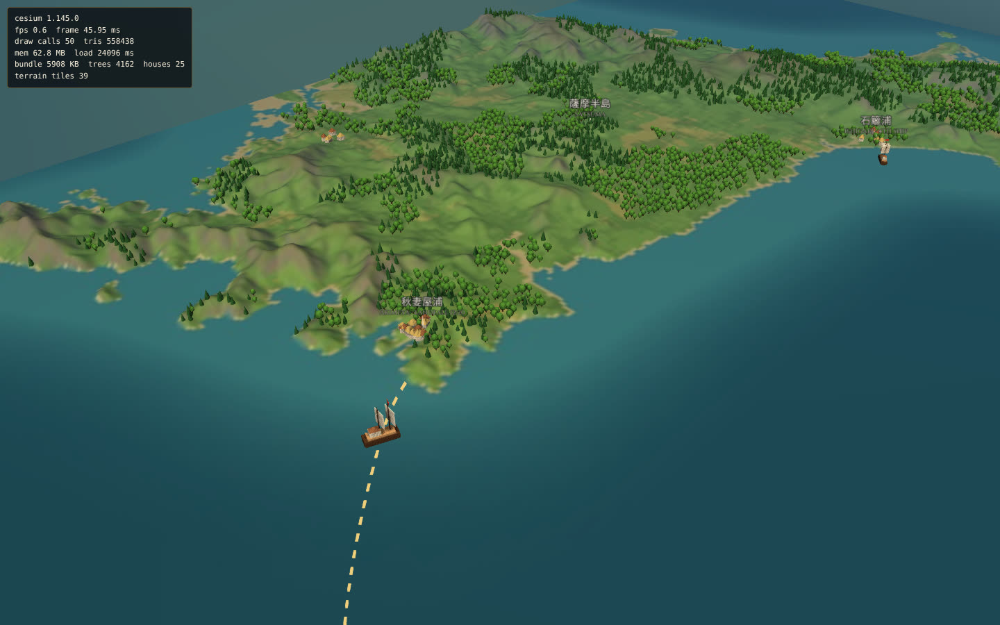
| 
| 

| Cesium | Three.js | Rust/wgpu
|===

=== Orbit, 90° and 180°

[cols="1,1,1"]
|===
| 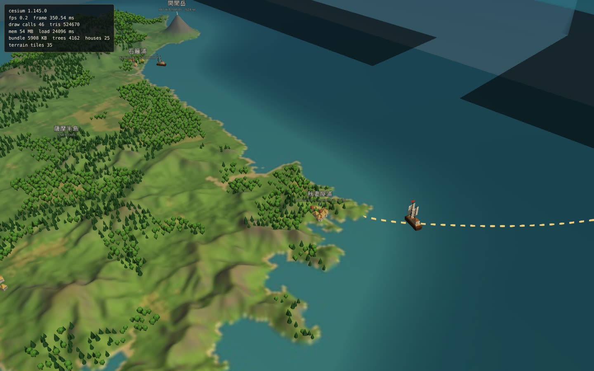
| 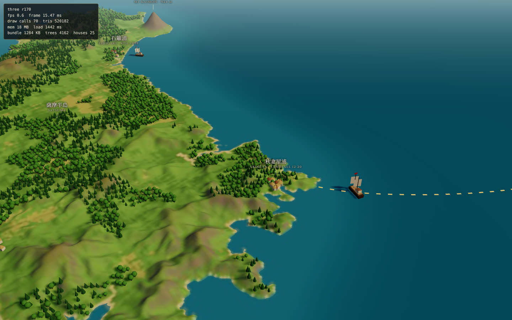
| 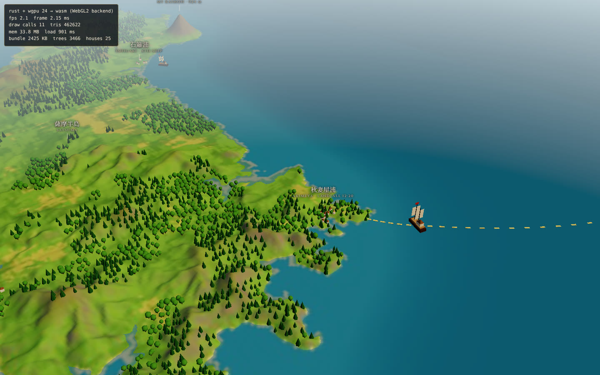

| 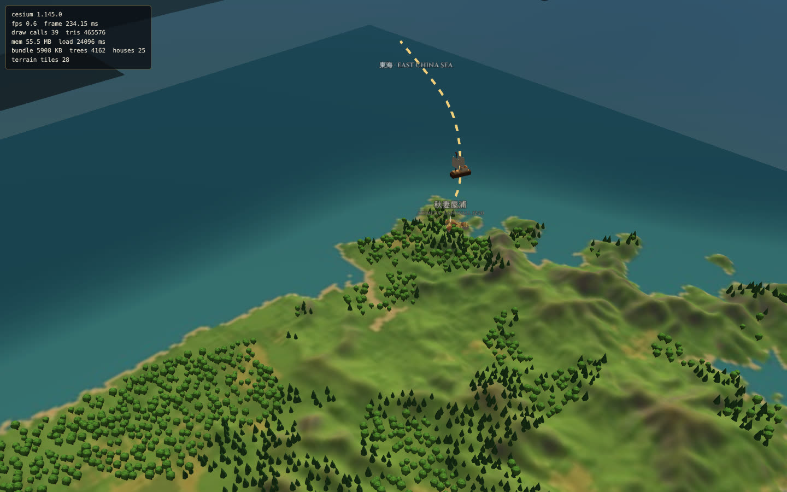
| 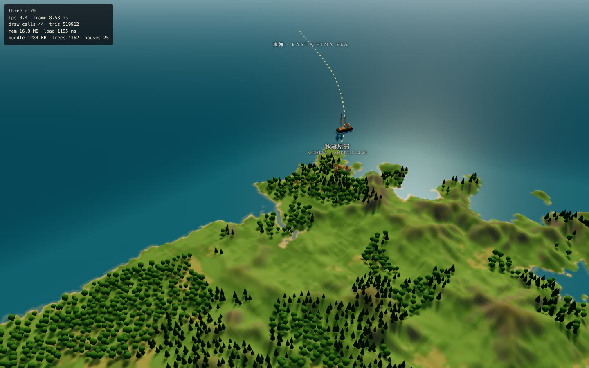
| 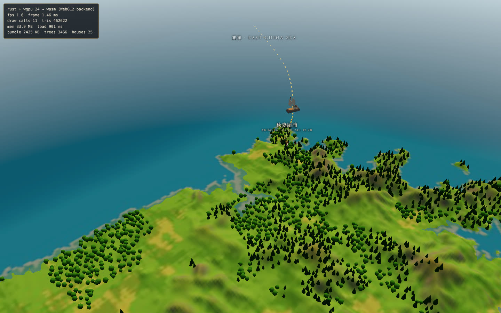
|===

=== Landfall (playhead at 1) and the phone tier (390 × 844, 2×)

[cols="1,1,1"]
|===
| 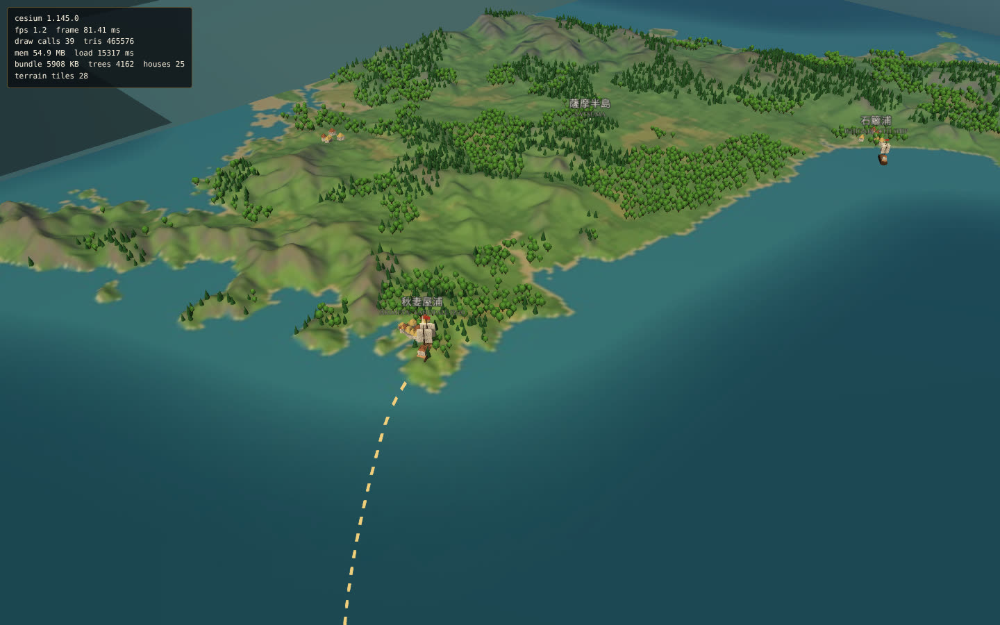
| 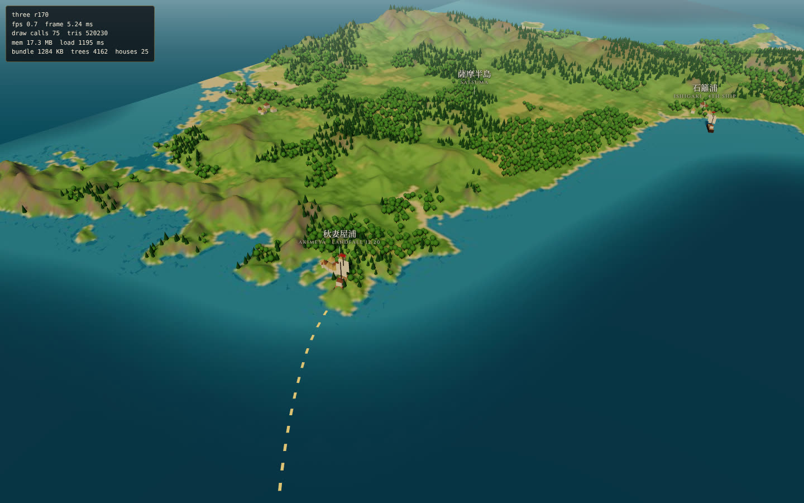
| 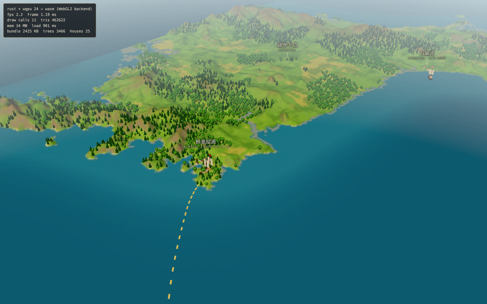

| 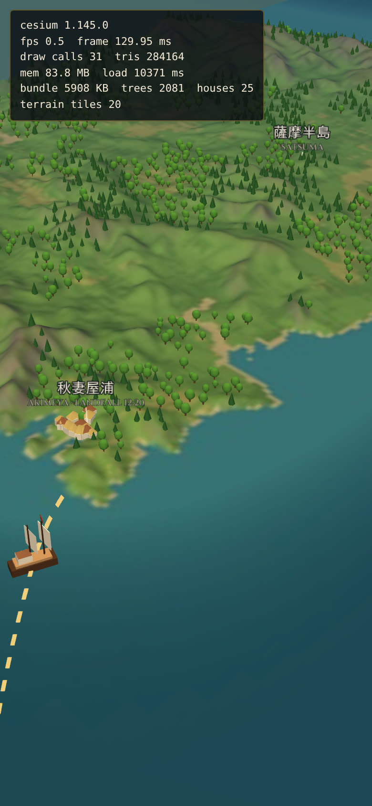
| 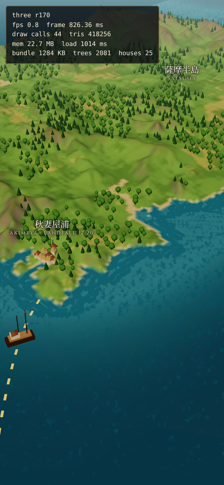
| 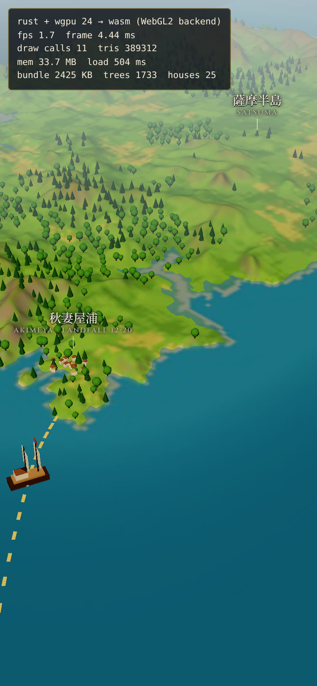
|===

=== Videos

[cols="1,1,1",options="header"]
|===
| Cesium | Three.js | Rust/wgpu

| link:spike/cesium/orbit.mp4[orbit (8 s)] · link:spike/cesium/playhead.mp4[playhead (6 s)]
| link:spike/three/orbit.mp4[orbit (8 s)] · link:spike/three/playhead.mp4[playhead (6 s)]
| link:spike/wgpu/orbit.mp4[orbit (8 s)] · link:spike/wgpu/playhead.mp4[playhead (6 s)]
|===

The videos are assembled frame by frame at 1280 × 800: the harness sets the
API, waits two animation frames, screenshots the page, and plays the frames
back at 10 per second. They show every step at the intended speed whatever
the renderer's real frame time, which is in the measurements below; they
are not real-time recordings. An earlier version filmed the page in real
time, which on a software GPU caught only a few composited frames and lost
the motion; it was replaced on 2026-10-10 after the videos were checked
frame by frame.

== Measurements

Taken by `stats()` after `ready`, then a four-second `requestAnimationFrame`
count (`measuredFps`). `frameMs` is the CPU time of one render call as the
page measures it, which on a software GPU excludes most of the work; the
measured frame rate is the honest number. `bundleKB` is the engine payload
the page downloads before it can draw anything, uncompressed; the gzip column
is measured separately. The raw files are `spike/<spike>/stats.json`.

The software GPU makes frame rates noisy: the same page measured up to
twice as fast on one run as on another. The spikes were captured two or
three times each on 2026-10-10, and the table gives the range across runs.
Read the frame rates as a rough ordering only. The "Better" column says
which direction is good for each row.

[cols="3,1,2,2,2",options="header"]
|===
| | Better | Cesium | Three.js | Rust/wgpu

| Engine payload, uncompressed | lower | 5,908 KB (Cesium.js, widgets.css, worker entry files) | 1,284 KB | 2,425 KB (wasm 2,357 KB + 68 KB glue)
| Engine payload, gzip | lower | 1,712 KB (Cesium.js alone) | 259 KB | 700 KB
| Runtime assets needed besides the payload | fewer | Workers, Assets, Widgets, ThirdParty (23 MB on disk, fetched on demand) | none | none
| Script start to `ready` (ms, in-page) | lower | 15,317–24,096 (39 terrain tiles, loaded a few per rendered frame on the software GPU) | 919–1,442 | 901–1,102
| Measured fps, full quality, 1440 × 900, software GPU | higher | 0.62–1.16 | 0.62–0.84 | 1.22–1.99
| Measured fps, phone quality, 390 × 844 at 2×, software GPU | higher | 1.38–2.48 | 1.04–2.32 | 1.59–3.47
| JS heap after load (MB) | lower | 50.9–77.9 | 17.7–18.5 | 33.8 (the terrain grid and texture are copied into wasm memory as well)
| Draw calls, full quality | lower, for the same picture | 50 (command-list entries; shadow pass not counted) | 75 | 11
| Triangles, full quality | neither; scene content | 558,438 (229,200 scene + ~329,000 terrain, estimated) | 520,230 | 462,622
| Trees placed, full / phone | neither; should match | 4,162 / 2,081 | 4,162 / 2,081 | 3,466 / 1,733
| Source size of the spike | lower | 420 JS + 39 HTML | 133 HTML+JS | 322 Rust + 78 WGSL + 57 HTML+JS
| Shadows | present | yes (one cascade, 2048², through a private field; barely visible) | yes (PCF soft, 2048²) | no
|===

The Rust probe places fewer trees than the JavaScript spikes from the same
rule because its hash runs in `f32` and theirs in `f64`; the rule's inputs
sit on the threshold often enough to move about 17% of the samples. A shared
engine would fix the rule's precision, not the engine. Cesium's and
Three.js's frame-rate ranges overlap, so this hardware cannot separate them.
The Rust probe is fastest on every run, but it draws no shadow pass, which
is most of the difference, not the language.

== Assessment

=== Cesium, stylized

*What the capture shows.* The diorama, recognisably, on the engine the atlas
already ships: exaggerated terrain under the painted texture, 4,162 batched
trees, the houses, both ships, the dashed route, the chapter's labels with
leaders, and the ship sailing to the landfall. Two things give it away. The
relief shading is baked into the imagery (a custom heightmap terrain provider
has no vertex normals, so the globe's lighting cannot shade the slopes), and
the cast shadows, though paid for, are barely visible. In the orbit frames
the far edge of the water rectangle and the globe's base colour meet as hard
bands at the horizon. Loading took 24 s in the container because Cesium
streams terrain a few tiles per rendered frame; on a real GPU that is a
second or two, but it is still a tile pipeline between the page and the
first frame.

*Strengths.*

* Already in the atlas: the globe, terrain streaming, camera controls,
  picking, the credit line, and the renderer boundary's existing coverage.
* The globe-to-region-to-local continuity the chapters need is native: one
  camera flies from the world to the peninsula without a hand-off between
  engines.
* Custom terrain and imagery providers accept the offline elevation and the
  painted texture from the pipeline RFD 3 plans, so the data path is the
  same one the production atlas would use.
* Labels, polylines, picking, and shadows exist and are maintained by
  someone else.

*Weaknesses.*

* The look is the GIS look unless fought: Cesium's lighting, atmosphere, fog,
  and water are globe-scale and tuned for photographic imagery; getting the
  diorama's warm sun, flat shading, and hand-painted sea means overriding
  shaders through private or semi-private API (`Material`, custom
  `ShaderSource`, post-process stages) that change between releases.
* Thousands of placed symbols are the expensive case: `Primitive` batching
  helps, but every instance is still an entity-sized object with a
  per-primitive bounding sphere, and per-frame culling and shadow passes are
  tuned for buildings and tilesets, not scattered glyphs.
* Payload: 5.9 MB of engine before the first frame, plus workers and
  assets fetched on demand, against 1.3 MB and 2.4 MB for the other two.
* The spike had to reach past the public API twice already: the shadow map
  is replaced through a private field to get one cascade that reaches 30 km,
  and the heightmap provider cannot deliver vertex normals, so relief
  lighting is static imagery. Each such reach is a line that breaks on an
  upgrade.
* The phone tier is still the full engine; `setQuality('phone')` can remove
  shadows and half the symbols, but it cannot make Cesium a small engine.

*Future extensibility.* Everything on RFD 3's rendering list that is
geospatial (journey lines, arcs, control polygons, places-with-events,
tiles, the globe) is Cesium's home ground. Everything that is stylistic (the
pixel look, custom tone mapping, painterly water, glyph symbols with
stylized shadows) is upstream of its public API and would be rebuilt on each
upgrade. The handheld 2D tier is a separate renderer on any choice.

=== Three.js, custom scene

*What the capture shows.* The diorama as the mock drew it: exaggerated terrain
under a warm sun, PCF shadows from the trees, houses and ships, the painted
sea darkening offshore, a dashed route, and the ship sailing to the landfall
in the playhead video. At one orbit angle the far edge of the sea planes
shows as a dark wedge against the sky, and facing the sun the water shows a
broad bright glint. The phone tier (no shadows, half the trees) keeps the
same picture. 75 draw calls and 520 k triangles at the full tier.

*Strengths.*

* Full control of the look, cheaply: the whole scene is 133 lines, and every
  choice in the hero mock (tone mapping, fog, water, instanced glyphs,
  shadow bias) is a documented public API.
* Instancing, shadows, tone mapping, text sprites, GLTF models, and
  post-processing are first-class and stable across releases.
* Payload is a fifth of Cesium's and needs no runtime asset tree.
* The ecosystem for stylized rendering (toon materials, outline passes,
  pixelation passes for the switchable pixel look) is the largest of the
  three.

*Weaknesses.*

* No globe of its own: Three.js has no tile streaming or geodetic camera.
  The `3d-tiles-renderer` package (0.5.3, maintained, built on Three.js)
  adds globe camera controls, a quantized-mesh terrain loader, and tiled
  imagery on the ellipsoid, so a Three.js globe is possible without
  rebuilding streaming. This spike did not test it.
* Picking, label collision, and the camera controller are the atlas's to
  write; the spike's labels are HTML projected per frame with no collision.
* A scene graph of JavaScript objects: 4,000 instances are cheap, but
  per-object animation of thousands of symbols is CPU-bound in JavaScript.
* Nothing is for free in geography: every geometry the chapter contract
  publishes (lines, arcs, polygons on terrain) is projected and draped by
  atlas code.

*Future extensibility.* The stylistic roadmap (pixel look, painterly passes,
glyph library, playhead-driven animation) is straightforward. The geospatial
roadmap is mostly atlas code: a chapter-extent terrain and basemap pipeline
(already planned offline), draping, and a world-scale fallback. Native
delivery stays open only through a browser shell.

=== Rust/wgpu probe (custom engine, loaded as wasm)

*What the capture shows.* The same scene, recognisably: terrain, texture,
sun and hemisphere lighting with the same tone curve, fog, water, 3,466
instanced trees, houses, ships, route, labels, and the playhead animation.
No shadows, so the picture is flatter than the other two; and the first
working frame took one afternoon of writing, two compile-fix rounds (vertex
attribute slot collision, WebGL2 limits), and an 11-draw-call frame.

*Strengths.*

* The smallest and most predictable frame: 11 draw calls, no scene-graph
  overhead, all geometry built once in Rust and uploaded; everything per
  frame is a handful of buffer writes.
* One codebase renders natively and in the browser: wgpu targets Vulkan,
  Metal, DX12, and WebGL2/WebGPU, so `AGENTS.md`'s "keep native delivery
  open" becomes a build target instead of a wish.
* Everything is ours: the asset format, the instancing scheme, the shading
  model, the memory layout. Nothing to fight, nothing to upgrade around.
* Heavy work (terrain normals, placement rules, path geometry) runs in Rust
  at native speed and off the JavaScript heap; the JS side is 57 lines.

*Weaknesses.*

* The floor is the floor: shadows, text rendering, picking, a camera
  controller, model loading, MSAA, mipmaps, tone mapping options, and a
  render graph are all unwritten. Each is a known quantity in Three.js and
  Cesium and a week-or-more each here.
* Payload: 2.4 MB of wasm (700 KB gzip) for a scene that does less than the
  Three.js page, because wgpu's WebGL2 backend ships a shader translator
  (naga) and a validation layer. A WebGPU-only build is smaller but excludes
  the browsers RFD 4's PoC must reach today.
* Toolchain: Rust, the `wasm32` target, `wasm-bindgen-cli` pinned to the
  crate version, and 90-second release builds. Contributors to the atlas
  would need all of it, or the wasm would be a committed binary.
* Browser integration is by hand: resize, pixel ratio, labels, input, and
  device loss each cross the wasm boundary, and debugging a wgpu validation
  panic in a browser is a worse experience than a Three.js stack trace.

*Future extensibility.* Unbounded in principle, and the only path to a
native atlas from one codebase. In practice it trades a year of engine work
for control the stylized hero does not obviously need. Where it earns its
keep is a specific, measured bottleneck that a library engine cannot meet:
hundreds of thousands of animated symbols, a terrain streamer with our own
tile format, or a native build. None of those is on RFD 4's PoC path.

== Proposal withdrawn, and the globe phase

The first proposal (Three.js for the diorama, Cesium retired) was withdrawn
on 2026-10-10 by the owner's decision. It gave up the globe, and the globe
is the experience: a reader explores an era across the whole Earth and
zooms in and out whenever they want, from the globe down to the diorama and
back. A comparison that drops the globe is not like for like, and this
record's region-scale evidence cannot decide the renderer on its own.

What the region-scale phase still shows, and what it cannot:

* It shows the look each engine reaches at local scale, the work each took,
  and each engine's payload. It shows that the Rust/wgpu path starts with
  nothing at globe scale, so it is out of the next phase.
* It cannot show continuity. Cesium's strongest property, one camera from
  the globe to the diorama, was never exercised, and Three.js was measured
  without any globe at all.
* Two of Cesium's weaknesses here came from the spike's shortcut, not the
  engine: a custom heightmap provider has no vertex normals, which forced
  the baked relief lighting. Quantized-mesh terrain tiles with the
  oct-encoded normals extension light dynamically in Cesium, and the same
  tiles load in `3d-tiles-renderer`.

The next phase compares the two engines that can carry a globe on equal
inputs:

. *One shared tileset built offline from open data*: quantized-mesh terrain
  with normals from the Terrarium elevation (coarse globally, fine over the
  chapter extent) and painted imagery tiles, both shipped as static files.
. *Cesium* with that terrain and imagery, the diorama symbols instanced as
  in this phase, and dynamic lighting instead of the bake.
. *Three.js with `3d-tiles-renderer`* reading the same tiles, with the
  Three.js diorama layer from this phase on top.
. *One flight both must make*: the whole globe in 753, down across the East
  China Sea to the landfall diorama, an orbit there, and back out to the
  globe, with symbols and labels appearing and thinning by altitude.
. *Measured the same way*: frame-by-frame videos of the flight, stills at
  globe, region and local altitude, frame rates at each altitude, payload,
  and the tile bytes each engine fetches. Real-device frame times are still
  the deciding numbers.

== Globe phase (2026-10-10)

The owner started the globe phase with three engines rather than two: Cesium,
Three.js with the maintained `3d-tiles-renderer` package, and a custom globe
on Three.js built for this atlas. Each flies the same path on the same files
and is measured the same way. The code is `spikes/renderer/globe/`; its
protocol is `spikes/renderer/globe/README.md`.

=== What was built

* *One shared tileset* (`build-tiles.py`), built offline from Terrarium
  elevation (AWS Open Data, attribution required) and Natural Earth II hue
  (public domain). One elevation sampler feeds quantized-mesh terrain with
  seamless oct-encoded normals (6,444 tiles, 43 MB), the same heights as
  65×65 Terrarium PNGs for the custom globe, and painted, unlit imagery on
  the same geographic tiling. Coverage is nested: the whole Earth to level 5,
  the East China Sea to level 8, southern Kyushu to level 10, the Satsuma
  peninsula to level 11 (about 150 m per height sample). Nothing is shipped;
  the script rebuilds it in about five minutes.
* *One scene contract* (`shared/scene.json`, `shared/diorama.json`,
  `shared/flight.js`): the globe in 753, a schematic voyage line from 黄泗浦
  to 秋妻屋浦 (not evidence), labels shown by camera range, and the
  region-scale diorama (4,162 trees, 25 houses, two ships) placed from the
  same rules as geodetic positions.
* *One flight* every engine makes: the whole globe at 16,000 km, down across
  the East China Sea, an orbit of the landfall at 29.5 km, and back out.
* *One harness* (`capture.mjs`): stills at globe, region and local range, the
  phone tier at the diorama, and a 14-second flight assembled frame by frame.
  Every frame waits for the engine to report its tiles loaded (up to a
  minute on the software GPU); no frame in any capture hit that cap.

=== Defects the spike found in its own data

The shared tileset had real bugs, found by the engines that read it, and
fixed before the captures:

* The mesh simplifier counts rows from the bottom; the builder read them
  from the top, so every terrain tile's vertex choice was mirrored and peaks
  were missed. Found by the Cesium spike.
* Triangles were clockwise, so both quantized-mesh engines culled the surface.
* Flat tiles collapsed to two triangles, chords sagging kilometres into the
  globe at coarse levels. The simplifier now also bounds curvature error.
* The encoder library's oct normals wrapped +1 to 0, flipping normals on
  three meridians.
* Imagery levels disagreed in colour, so seams showed where two levels met,
  and narrow land took the sea's blue from a blurred hue map.
* Sea vertices carried the slope normals of the coast, which streaked the
  water in the simplified meshes.

The custom globe reads the PNG heights and was not affected by the mesh bugs.
The client-side repairs the Cesium spike wrote while the tiles were wrong
remain behind URL switches, off in every capture.

=== Proof of work

Stills at 1440 × 900 unless noted. Media in link:spike/globe/[`rfd/0003/spike/globe/`].

[cols="h,3,3,3",options="header"]
|===
| | Cesium | Three.js + 3d-tiles-renderer | Custom Three.js globe

| Globe, 16,000 km
| 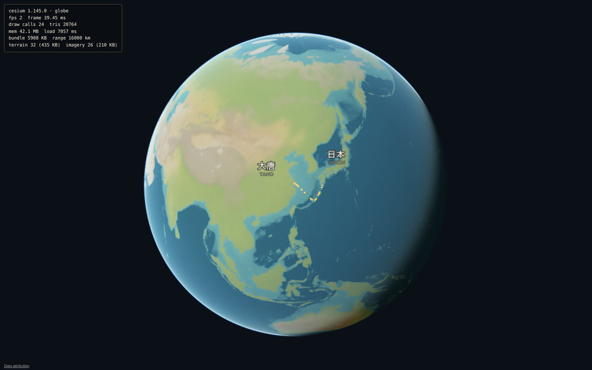
| 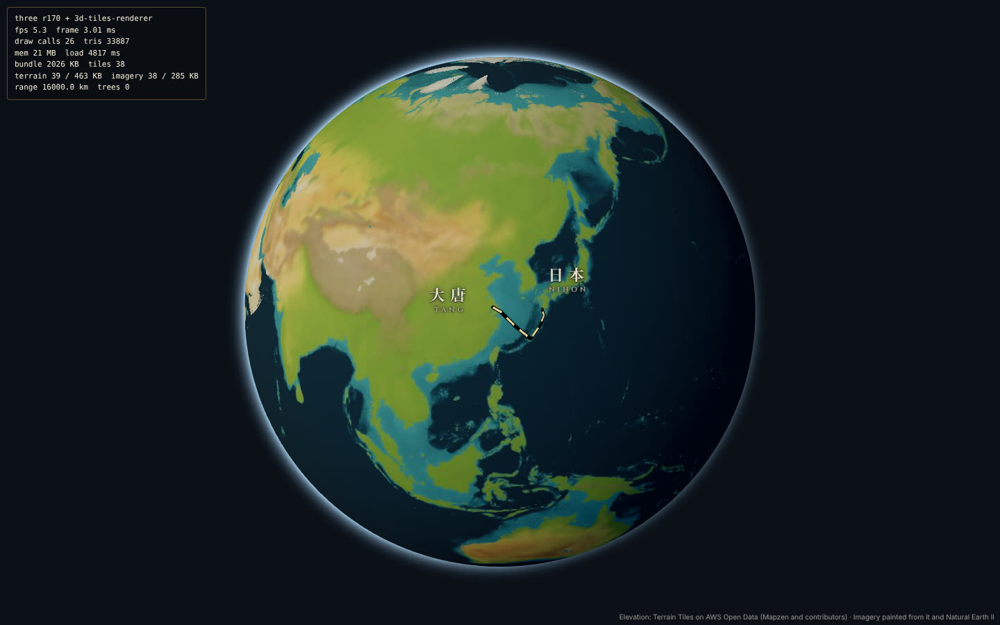
| 

| Region, 1,500 km
| 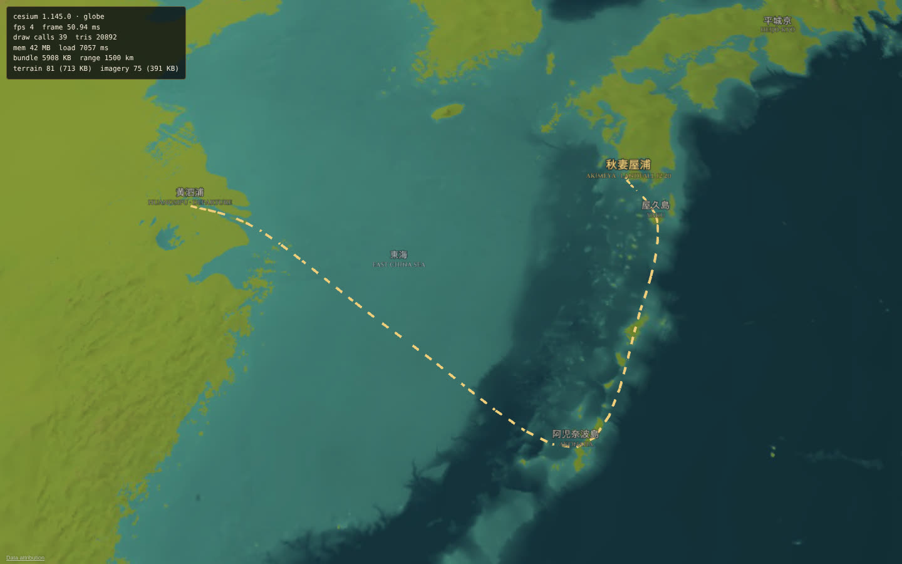
| 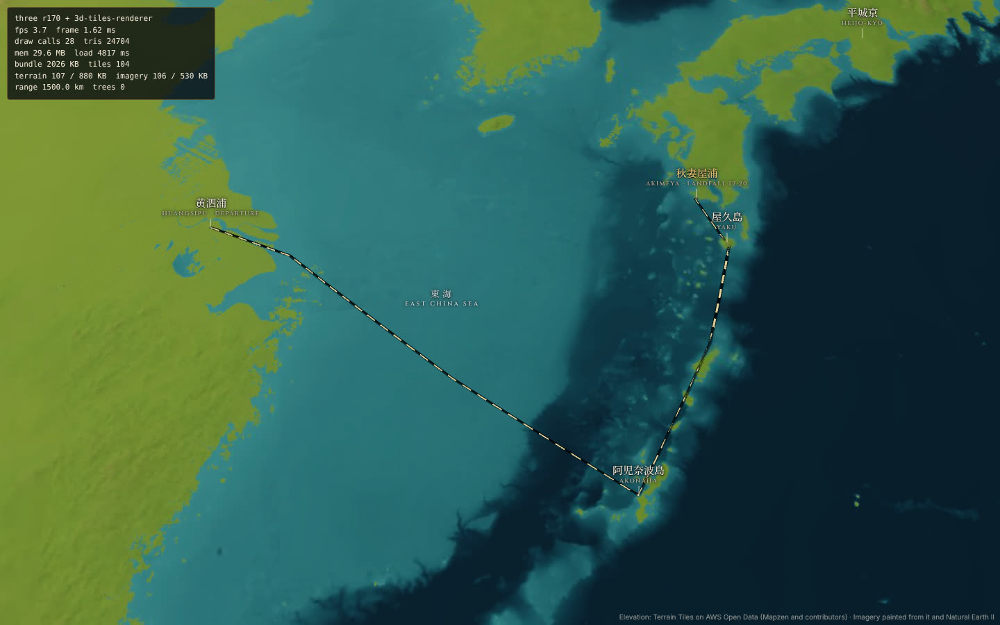
| 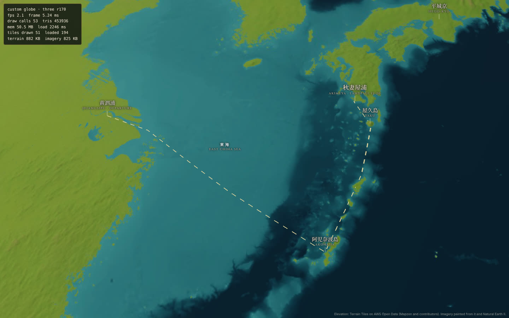

| Diorama, 29.5 km
| 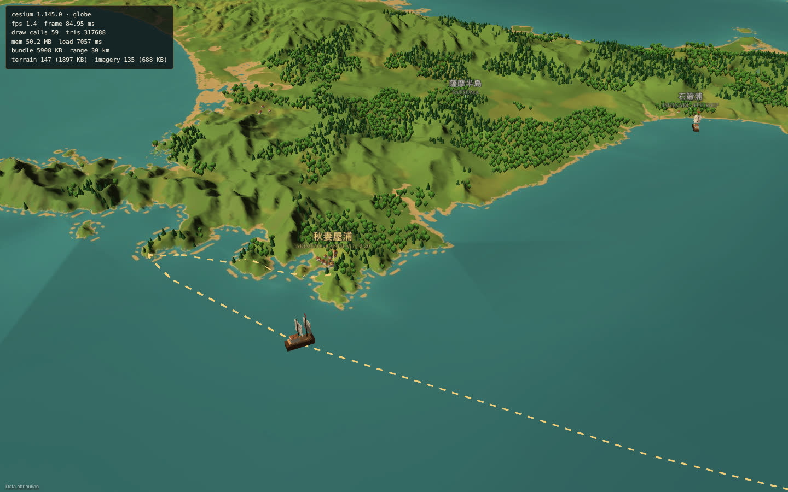
| 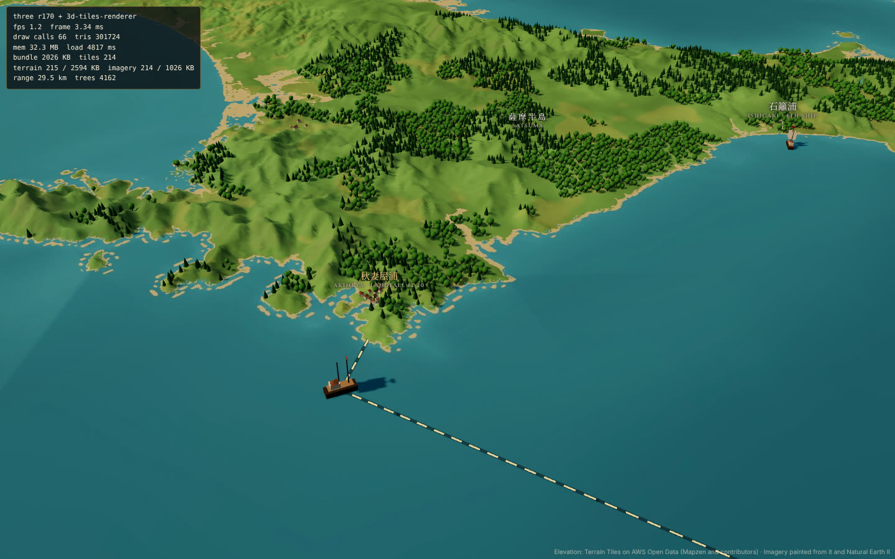
| 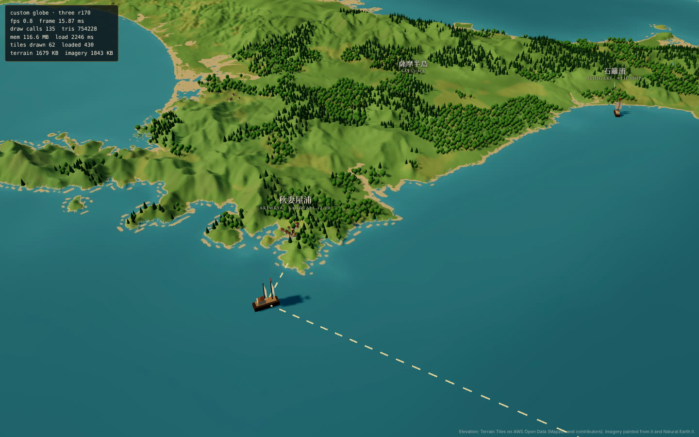

| Phone tier, 390 × 844 at 2×
| 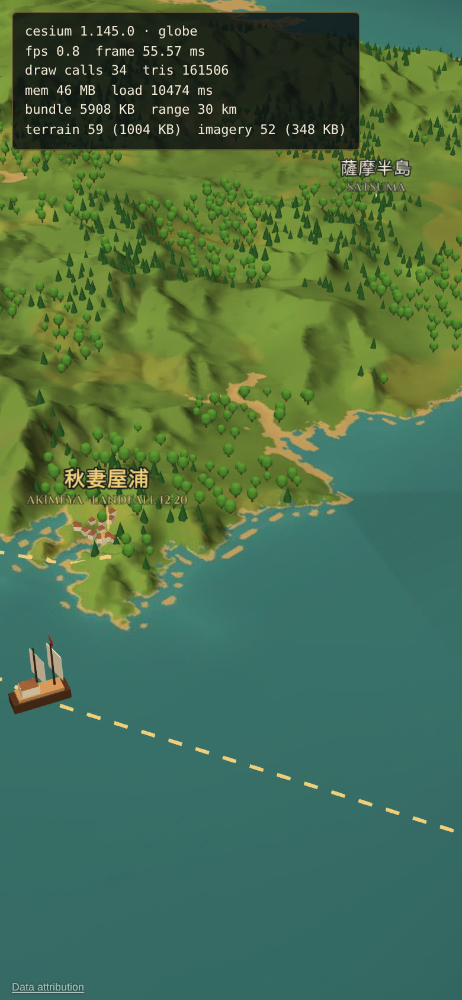
| 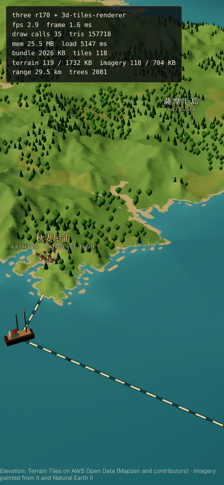
| 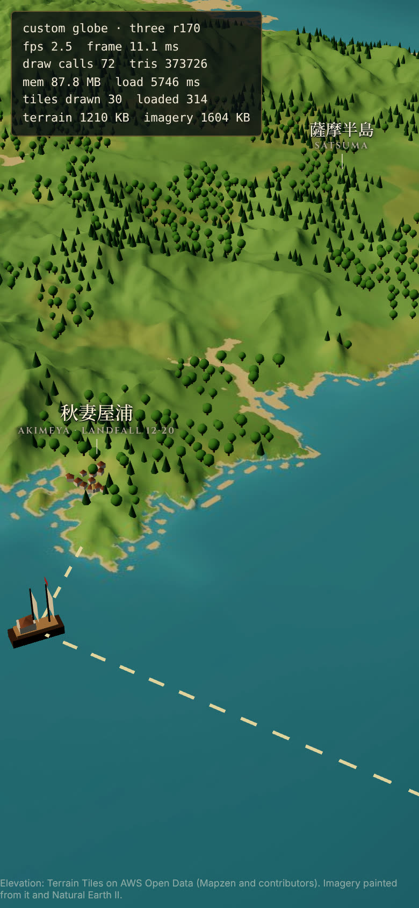

| Flight, 14 s
| link:spike/globe/cesium/flight.mp4[flight.mp4]
| link:spike/globe/tilesjs/flight.mp4[flight.mp4]
| link:spike/globe/custom/flight.mp4[flight.mp4]
|===

Every flight video was checked frame by frame. All three show the same
sequence: the globe, the descent with the route and region labels, the
peninsula appearing with its trees and houses, the full orbit, and the climb
back to the globe. On the return leg the flight's target slides west over
open sea before the camera has climbed, so for about half a second every
engine shows only water; that is the flight path, not a rendering fault.

=== Measurements

Single captures on the container's software GPU, one engine at a time.
Frame rates are noisy (up to twice as fast on another run in the region
phase) and only order the engines roughly. The "Better" column gives the
direction of each row.

[cols="3,1,2,2,2",options="header"]
|===
| | Better | Cesium | 3d-tiles-renderer | Custom

| Engine JavaScript loaded | lower | 5,908 KB, plus workers and assets on demand | 2,026 KB | 1,314 KB (Three.js) + 30 KB
| Page load to first settled globe | lower | 7.9 s | 5.2 s | 2.7 s
| Measured fps at the globe / region / diorama | higher | 2.1 / 2.7 / 1.5 | 6.0 / 3.9 / 1.2 | 3.6 / 2.1 / 0.9
| Measured fps, phone tier at the diorama | higher | 2.2 | 3.0 | 2.5
| Tiles fetched over the whole flight | lower, for the same picture | 440 terrain + 432 imagery | 593 + 592 | 1,006 + 1,006
| Tile kilobytes over the whole flight | lower, for the same picture | 2,912 + 1,447 | 3,931 + 2,035 | 2,757 + 3,139
| Draw calls at the diorama | lower, for the same picture | 59 | 66 | 135
| JS heap at the diorama | lower | 47 MB | 33 MB | 100 MB
| Flight frames that did not settle in a minute | lower | 0 of 140 | 0 of 140 | 0 of 140
| Source of the spike (lines) | lower | 523 JS + 41 HTML | 421 JS + 36 HTML | 373 JS + 25 HTML
| Private API or library internals used | fewer | shadow map camera; render list for stats | overlay internals subclassed, one private method | none
|===

The custom globe refines further than the other two (1,006 tiles, about
twice the draw calls), because it keeps every level's full 65×65 grid and
uses Cesium's per-level error with a two-pixel target. That is tuning, not
engine quality: a looser target or simplified meshes would bring it down.
Its heap is higher for the same reason.

=== Assessment

==== Cesium

*What the capture shows.* The full flight on the engine the atlas ships
today, with dynamic lighting from the shared normals instead of the
region phase's baked relief. Faint triangular shading remains on the sea
near coasts, where long simplified triangles meet; Cesium's water-mask
extension in the terrain tiles is the standard cure. Labels are canvas text
and read softer than the HTML labels of the other two.

*Strengths.* The globe, terrain streaming, camera controls, picking,
draped lines and polygons, and labels are built in and mature; the camera
matched the shared flight to the millimetre. It read the standard tiles
without help once they were correct. Nested imagery coverage is expressible
with public options (`minimumTerrainLevel`).

*Weaknesses.* The heaviest payload by far. Shadows that reach the diorama
need a private shadow-map camera. It loads tiles a few per rendered frame,
which is slow on weak GPUs. Stylization beyond imagery and lighting (the
pixel look, custom tone mapping) is upstream of its public API, as the
region phase found.

*Future extensibility.* Everything geospatial the atlas will add (journey
lines, arcs, control polygons draped over terrain, picking) is built in.
Everything stylistic stays a fight with each upgrade.

==== Three.js with 3d-tiles-renderer

*What the capture shows.* The same flight with the region phase's Three.js
look: the same diorama code, soft shadows, HTML labels, a limb glow. The
highest frame rates at globe and region range in this run.

*Strengths.* One rendering stack with the diorama work. The package brings
quantized-mesh loading, image overlays on the ellipsoid, globe camera
controls, and an active maintainer (0.5.3, updated weeks ago). Its
`GeoJSONOverlay` can rasterize polygons onto terrain, a route to draped
control polygons.

*Weaknesses.* It needed the most adaptation: vertical exaggeration by
wrapping the plugin's mesh parser and stretching normals; one overlay
subclass per imagery group, overriding internals, to express nested
coverage without 404s; and a workaround for a reversed `smoothstep` in the
overlay shader that dropped imagery on vertices at the top of a tile's
height range (worth reporting upstream). The diorama needed up to 90 s to
settle on the software GPU. A 0.x library whose internals we override is an
upgrade risk.

*Future extensibility.* Good for stylization (the whole Three.js ecosystem)
and reasonable for geospatial overlays; each new kind of data likely means
another plugin or overlay to adapt.

==== Custom Three.js globe

*What the capture shows.* The same flight from 373 lines: a quadtree over
the shared tiling chosen by screen-space error, full-grid heights with
skirts, imagery mapped one to one, parent quadrants where the tileset stops,
the diorama placed in exact Earth coordinates, and a logarithmic depth
buffer. The fastest load.

*Strengths.* No workarounds and no private API: every behaviour is ours and
fits this atlas (our tiling, our exaggeration, our levels). The smallest
payload. Because the engine is small, porting it later (to the Rust/wgpu
native path, for instance) is a bounded job.

*Weaknesses.* It has no interaction yet: no camera controls, no picking, no
draped lines or polygons beyond the route, no request cancellation. Normals
are one-sided at tile edges. Its level-of-detail rule fetches more than the
other two and needs tuning. All of that is ours to build and maintain.

*Future extensibility.* Unlimited and fully ours, at the cost of writing
each feature. `3d-tiles-renderer`'s `GlobeControls` and ellipsoid maths are
separable and could give it interaction without adopting the tile renderer;
that is untested.

=== Proposal (owner decides)

All three carry the globe-to-diorama flight on identical data with a similar
look, so the requirement no longer separates them by picture; it separates
them by what each costs to finish.

The proposal is the *custom Three.js globe on the shared tileset*, with
interaction borrowed from `3d-tiles-renderer`'s `GlobeControls`, and a
one-week follow-up spike to prove the missing pieces before committing:

. camera controls (GlobeControls on the custom tile meshes) and picking of
  places and symbols;
. one draped control polygon and one relationship arc across the sea;
. level-of-detail tuning to fetch no more than Cesium for the same flight;
. frame times on the desktop, a physical iPad, and a mid-range phone.

Why: it met the contract with no workarounds, it is the lightest, it shares
one rendering stack with the diorama look, and the tile format stays a
standard quantized-mesh and PNG pair that Cesium and `3d-tiles-renderer`
can still read. If the follow-up fails on controls or draping,
`3d-tiles-renderer` is the fallback on the same stack and the same tiles; if
it fails on geospatial breadth, Cesium remains viable on the same tiles.

== Custom globe follow-up (2026-10-10)

The owner asked for the proposal's follow-up spike on the custom globe, to see
whether it gets to what the atlas needs. It took the four questions the
proposal set and answered three of them in the container; the fourth needs
the owner's devices. No decision is recorded here: the proposal stays open.

The code is `spikes/renderer/globe/followup/`. The globe phase's `custom/` is
left exactly as captured, so the comparison above stays reproducible.

=== What was built

* *The engine as a module* (`globe.js`, 233 lines): the same quadtree,
  heights, skirts and imagery, with the level-of-detail target as a
  parameter and the tiles as ordinary meshes that controls and picking can
  raycast.
* *Camera controls*: `GlobeControls` from `3d-tiles-renderer` 0.5.3, used
  alone, on the custom tile meshes and the WGS84 ellipsoid. No tile
  renderer, no plugin, no subclass. Drag turns the globe, the wheel or a
  pinch zooms toward the cursor, right-drag or two fingers tilt, with
  damping. The scripted flight hands over to the reader on the first input.
* *Picking* in one function, in priority order: diorama symbols (ships,
  forests, settlements), then lines and arcs within 10 px of the pointer,
  then the terrain, which resolves to the draped polygon under it, the sea,
  or the ground with longitude, latitude and height. Labels are clickable
  too. Each pick opens a card with the item's kind and caveat.
* *Draping* (`overlay.js`, 53 lines): polygons are rasterized per tile, in
  that tile's own longitude and latitude, onto a small texture the tile
  samples over its imagery on a second UV set. A tile the shapes do not
  touch gets nothing. The shape follows the terrain exactly and stays sharp
  from the globe to the diorama.
* *A relationship arc*: a great-circle curve lifted in proportion to its
  length, drawn as a screen-space line with a colour ramp, pickable.
* *Spike data* (`followup.json`): a schematic outline of 薩摩国 and a
  schematic 遣唐使 arc from 平城京 to 揚州. Both say on their cards that
  they are not sourced; they exist to test draping and arcs.
* *A real-device bench* (`?bench=N`): plays the flight in real time for N
  seconds and reports frame times (median, 95th percentile, worst, share
  over 33 ms) with a Copy button.
* *An interaction capture* (`capture-interaction.mjs`): real mouse input
  through Playwright, one screenshot per input step, with a drawn cursor and
  a caption, assembled into a video. Picks are found by asking the page's
  own picker over a grid, so the clicks are not tuned to pixel positions.

=== Results against the four questions

. *Controls and picking: met.* Drag, zoom to the cursor (from 1,500 km to
  29 km at the landfall in one gesture sequence) and tilt all work on the
  custom tiles, and every kind of target returns the right card: a label,
  a ship, the voyage line, the arc, the province, the ground and the sea.
  See the interaction video and the pick stills below.
. *One draped polygon and one arc: met, with one visible flaw.* Both read
  from the globe to the diorama (they are in every flight frame from the
  region view down). In tilted views the province outline gets thicker
  where a coarse tile meets a finer one, because the outline is drawn a
  fixed number of texels wide per tile. A sharper overlay texture does not
  help; the fix is to draw outlines as screen-space lines, like the voyage
  line, and keep only the fill draped.
. *Level of detail no greater than Cesium's: met.* Two changes. Tiles are
  now bounded by their real heights instead of the highest terrain on
  Earth, which the globe phase's version assumed for every tile and which
  made sea tiles look near. And the detail target moved from 2 px to
  4.5 px. Over the shared flight the follow-up fetches 424 height and 424
  imagery tiles (Cesium: 440 terrain and 432 imagery), 2,725 KB in all
  (Cesium: 4,359 KB). The diorama, region and globe stills are
  indistinguishable from the 2 px version.
. *Frame times on the desktop, a physical iPad and a mid-range phone: not
  measured.* The container has only a software GPU. The bench mode is
  ready for the owner to run; see "Real devices" below.

=== Level-of-detail tuning

Tiles fetched over the 140-frame flight, height plus imagery, one run per
setting. The pictures were compared at the diorama.

[cols="1,2,2,1,3",options="header"]
|===
| Target (px) | Tiles, every tile bounded at 19.8 km | Tiles, real height bounds | KB, real bounds | At the diorama

| 2 | 1,006 + 1,006 | 836 + 836 | 2,185 + 2,698 | the globe phase's picture
| 3 | 656 + 656 | 592 + 592 | 1,444 + 1,989 | same
| 4 | 516 + 516 | 464 + 464 | 1,206 + 1,724 | same
| *4.5 (default)* | | *424 + 424* | *1,127 + 1,598* | same terrain; outline flaw visible
| 5 | | 396 + 396 | 1,063 + 1,487 | same terrain; outline flaw visible
| 6 | 398 + 398 | | | not compared
|===

Cesium reaches 440 tiles with a 2 px target because it also relaxes detail
toward the horizon where its fog hides it. The custom globe has no fog; a
horizon relaxation of its own would let it keep a tighter target near the
camera.

=== Proof of work

Stills at 1440 × 900 unless noted, from the same harness as the globe
phase. Media in link:spike/globe/followup/[`rfd/0003/spike/globe/followup/`].

[cols="h,3,3",options="header"]
|===
| | Globe phase (`custom/`) | Follow-up

| Globe, 16,000 km
| 
| 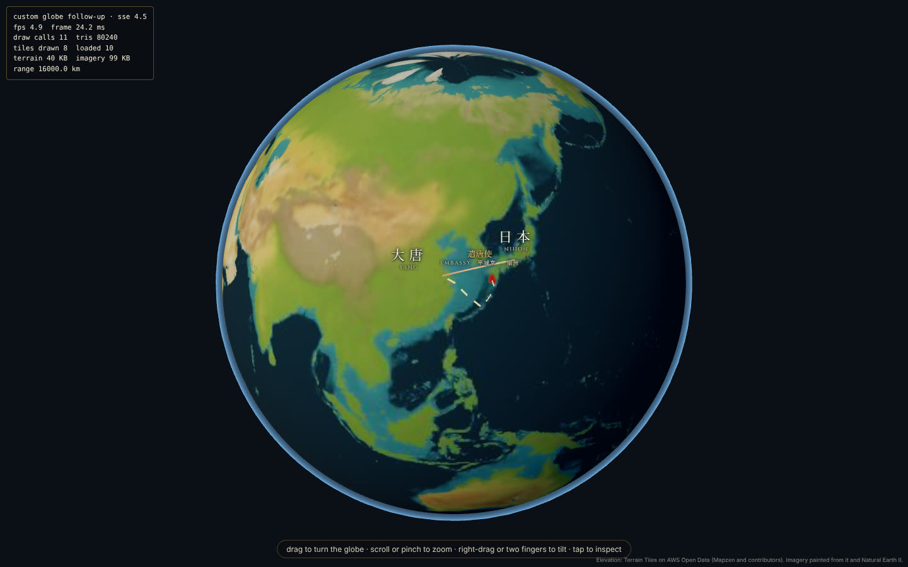

| Region, 1,500 km
| 
| 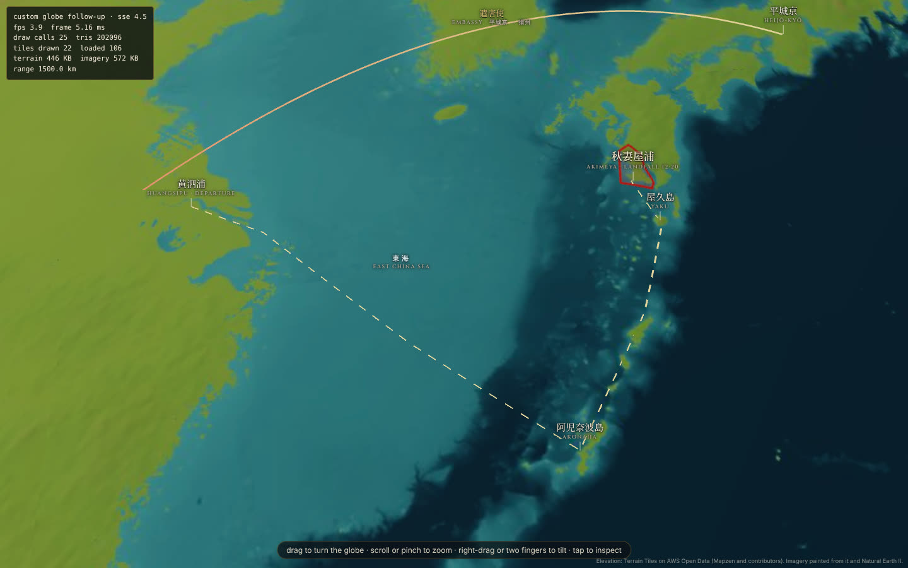

| Diorama, 29.5 km
| 
| 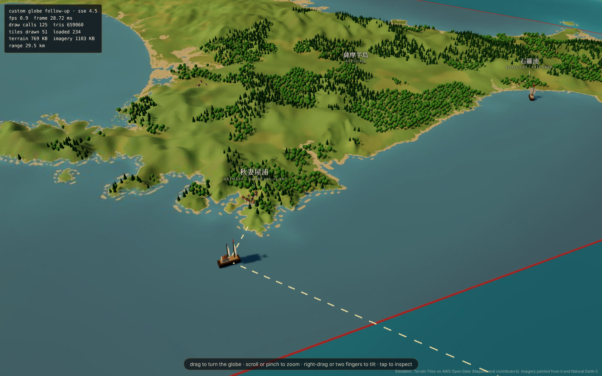

| Phone tier, 390 × 844 at 2×
| 
| 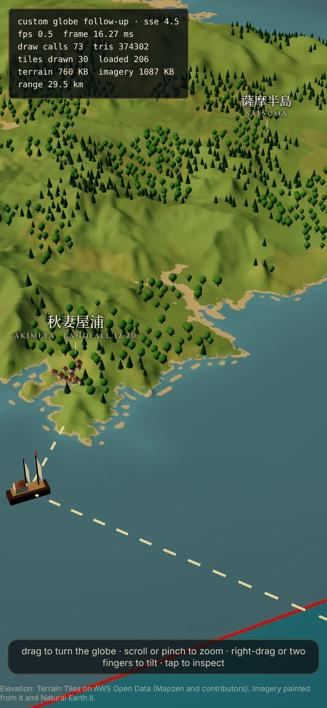

| Flight, 14 s
| link:spike/globe/custom/flight.mp4[flight.mp4]
| link:spike/globe/followup/flight.mp4[flight.mp4]
|===

Interaction, 1280 × 800:
link:spike/globe/followup/interaction.mp4[interaction.mp4] (drag, zoom to
the cursor, tilt, then clicks on each kind of target).

[cols="1,1,1",options="header"]
|===
| Label | Ship | Province

| 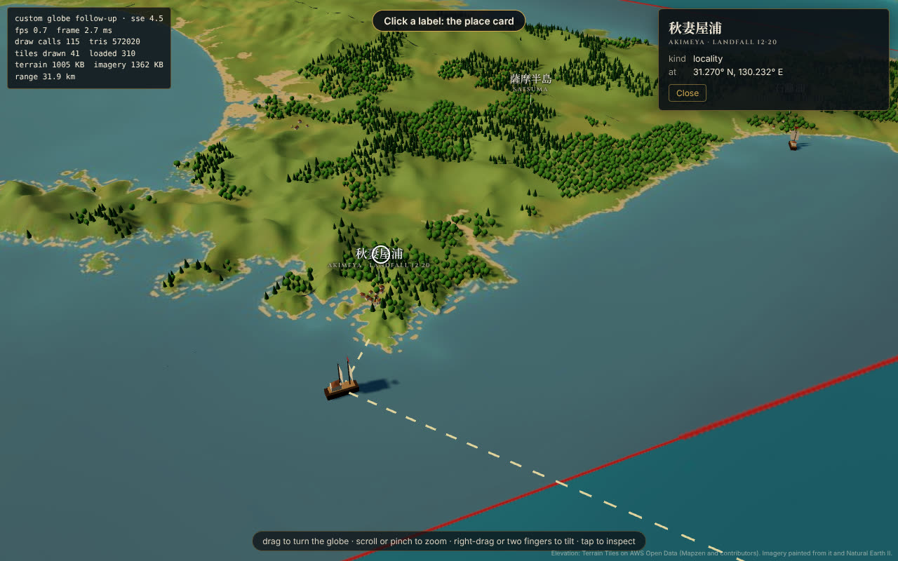
| 
| 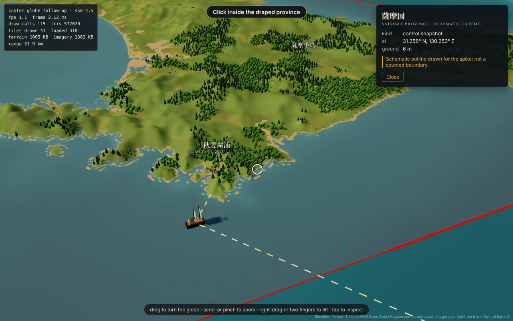

h| Ground h| Sea h| Arc

| 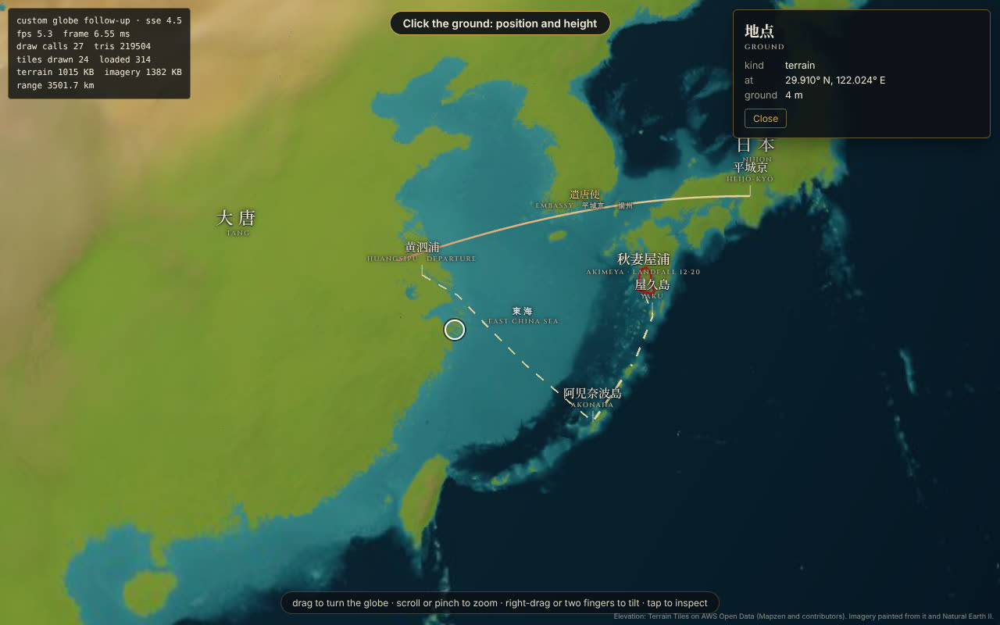
| 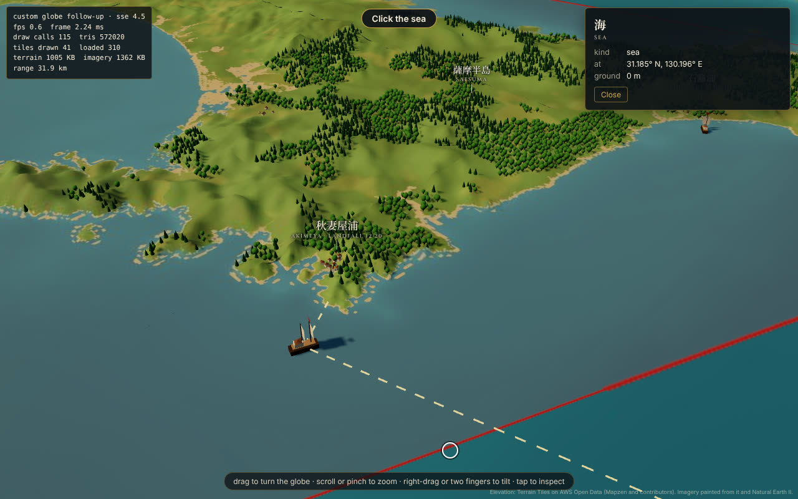
| 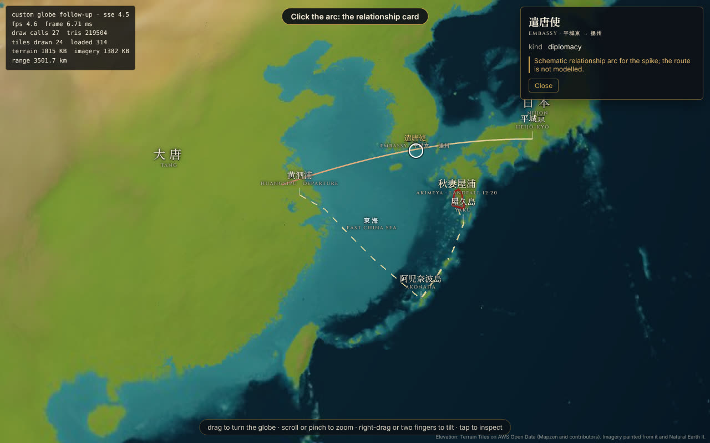
|===

Every flight frame was checked: the same sequence as the globe phase, with
the arc and the province on the surface from the region view down, and the
same half-second of open sea on the return.

=== Measurements

Single captures on the container's software GPU, as in the globe phase, with
the same caveat about noisy frame rates.

[cols="3,1,2,2,2",options="header"]
|===
| | Better | Cesium | Custom, globe phase | Custom, follow-up

| Engine JavaScript loaded | lower | 5,908 KB | 1,344 KB | 1,574 KB (adds `GlobeControls` and screen-space lines)
| Page load to first settled globe | lower | 7.9 s | 2.7 s | 2.3 s
| Measured fps at the globe / region / diorama | higher | 2.1 / 2.7 / 1.5 | 3.6 / 2.1 / 0.9 | 6.0 / 3.9 / 1.0
| Measured fps, phone tier at the diorama | higher | 2.2 | 2.5 | 2.4
| Tiles fetched over the whole flight | lower, for the same picture | 440 + 432 | 1,006 + 1,006 | 424 + 424
| Tile kilobytes over the whole flight | lower, for the same picture | 2,912 + 1,447 | 2,757 + 3,139 | 1,127 + 1,598
| Draw calls at the diorama | lower, for the same picture | 59 | 135 | 125
| JS heap at the diorama | lower | 47 MB | 100 MB | 68 MB
| Flight frames that did not settle in a minute | lower | 0 of 140 | 0 of 140 | 0 of 140
| Source of the spike (lines) | lower | 523 JS + 41 HTML | 373 JS + 25 HTML | 614 JS + 46 HTML
| Private API or library internals used | fewer | shadow map camera; render list for stats | none | none
|===

Draw calls stay about twice Cesium's: each tile is its own mesh with its own
material. Merging tiles that share an imagery texture, or an array texture,
is the known cure and was not needed to answer the questions.

=== Gaps found

* The outline-width step on draped polygons, above.
* No sky at low tilt: looking toward the horizon shows the atmosphere rim
  and then black space. Cesium and the `3d-tiles-renderer` spike draw a sky
  gradient there.
* A drag that starts on label text does not turn the globe (labels take
  the pointer so they can be clicked). Wheel events over labels are
  forwarded and zoom normally.
* Touch pinch and two-finger tilt are `GlobeControls`' own and were not
  exercised: the container has no touch input. The bench on a phone or iPad
  is the first real test.
* Normals at tile edges are still one-sided, as in the globe phase; no seam
  was visible in the captures.

=== Real devices

The bench runs the flight in real time on the device in hand and reports
frame times. On a machine on the same network as the devices:

    python3 -I spikes/renderer/globe/build-tiles.py      # once, if tiles/ is missing
    HOST=0.0.0.0 node spikes/renderer/serve.mjs          # serves the repository on the LAN, port 4300

Then open `http://<that machine's address>:4300/spikes/renderer/globe/followup/?bench=24`
on the desktop, the iPad and the phone, wait 24 seconds, and copy the report.
`?sse=` changes the detail target for a comparison run. The results belong in
this record, under this section, with the device names.

=== What the follow-up means for the proposal

On the three questions the container can answer, the custom globe got to
what the atlas needs without workarounds or private API, and it now fetches
less than Cesium for the same flight. The remaining unknown is the one the
proposal always deferred to the owner: frame times on real devices. The
gaps above are ordinary engine work, each with a known fix.

== Reproduce

    python3 -I spikes/renderer/globe/build-tiles.py       # the shared tileset, about five minutes
    node spikes/renderer/serve.mjs                        # serves the repository on :4300
    node spikes/renderer/globe/capture.mjs custom         # also cesium, tilesjs
    sh spikes/renderer/globe/publish-evidence.sh custom   # → rfd/0003/spike/globe/custom/
    node spikes/renderer/globe/capture.mjs followup       # the follow-up, same harness
    node spikes/renderer/globe/followup/capture-interaction.mjs
    sh spikes/renderer/globe/publish-evidence.sh followup

The region-scale phase is reproduced from commit `9337056`
(`node spikes/renderer/capture.mjs three|cesium|wgpu`).

The curated copies under `rfd/0003/spike/globe/` are made from the harness
output by `spikes/renderer/globe/publish-evidence.sh`. The harness needs Chromium with WebGL
(Playwright's build with `--use-angle=swiftshader` in a container) and an
`ffmpeg` with libx264.
