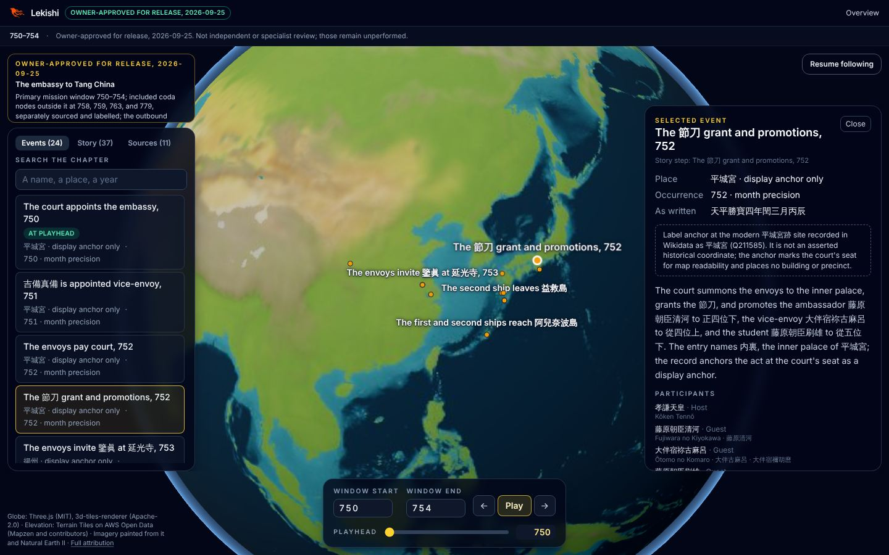

:authors: Darwin D Wu <darwin67@users.noreply.github.com>
:state: discussion
:discussion: https://github.com/lekishi/lekishi/pull/21
:labels: design-system, ui, layout, typography, accessibility

= RFD 5 Design system and layout

== Why now

The owner asked on 2026-10-13 whether Lekishi should start a design system and
a layout before more components are built, because the visual mocks are not
enough and the existing interface was not thought through as a whole.

The answer this RFD proposes is yes, and that it should be small, derived from
the approved hero rather than from a component kit, and enforced by the build
rather than by review. Track 1 (link:../0004/README.adoc[RFD 4]) is about to add
roughly a dozen new surfaces (date bar, layer orbs, journal, pennants, minimap,
next-event dial, timeline strip, selection card, About sheet, honesty plate,
legend, the handheld tier). Built on today's footing, each would invent its own
colours, sizes and spacing, as the existing nine components already have.

This RFD owns the interface's visual language: tokens, type, the component
inventory and the page layout. It does not change what is drawn or claimed;
link:../0001/README.adoc[RFD 1] owns the experience and its evidence grammar,
and the hero it approved stays the acceptance bar. It does not change the
renderer boundary that link:../0003/README.adoc[RFD 3] owns, except where
<<Scene safe area>> proposes one new input.

== Audit, 2026-10-13

Measured at `main` @ 0e07e43.

=== The hero has a system; the code does not use it

The approved mock (link:../0001/hero/template.html[`hero/template.html`])
already declares a small palette and three type families as CSS variables:
`--bg #0c1216`, `--lacquer rgba(16,22,27,.86)`, `--ink #f3ead7`,
`--ink-dim #b9af9c`, `--ink-faint #7f786b`, `--gold #d2a94f`,
`--gold-bright #f1cf7a`, `--jade #79c3b4`, `--vermilion #d9593e`, with Cinzel
for display, Noto Serif JP for names and Noto Sans JP for the interface. None
of it reached `src/`. The served atlas uses Tailwind's default slate and amber
and the operating system's font, so the hero and the product read as two
different projects.

=== The shipped interface, counted

[cols="1,1,3",options="header"]
|===
|What |Count in `src/` |Reading

|Colour families
|7 (slate 164 uses, amber 49, sky 16, white 15, rose 12, emerald 12, violet 5)
|Hues carry meaning ad hoc. Amber is the focus ring, the primary button, the
notice border and the BCE hint. Sky means both "possible at the playhead" and
"outside the window", two different states. Rose is both "disputed account" and
"renderer failed".

|Arbitrary text sizes
|35 uses of `text-[0.6rem]`, `[0.65rem]`, `[0.7rem]`
|9.6 px to 11.2 px. Below a readable size for CJK, which the chapters are
written in.

|Corner radii
|8 (`rounded`, `-sm`, `-md`, `-lg`, `-xl`, `-2xl`, `-full`, `-t`)
|Panels, rows, buttons and badges each pick a different one.

|Letter-spacing values
|6
|Uppercase labels use `0.14em`, `0.18em`, `0.2em` and `wide` interchangeably.

|Panel surfaces
|9 variants of `bg-slate-900`/`950` at opacities 40–95 %
|The same "panel on the map" is drawn nine ways.

|Repeated focus-ring strings
|16
|The intent is consistent; the implementation is copy-paste.

|Colour sources outside Tailwind
|`MARKER_COLORS` and `#0f172a` in `globe/view.ts`
|Markers and labels on the globe use a second palette nobody else sees.

|Fonts loaded
|0
|CJK falls back to whatever the reader's system has; RFD 1 requires fonts
with the script coverage the chapter needs.
|===

There are no shared primitives: a button, a badge, a panel and a section label
are each re-spelled in Tailwind utilities wherever they appear, so a change to
"what a badge looks like" is a search across files.

=== The layout is one overlay column

`AtlasWorkspace.svelte` stacks the notice, the follow and list buttons, the
tabbed panel and the details panel in one absolutely positioned column, bounded
by a measured `controlsHeight + 24` px, with the details panel pinned at the
magic offset `md:top-[5.25rem]`. That column is what has kept the overlays from
overlapping at 320 and 390 px, and its comments record why, but it has no named
regions, so every new surface has to negotiate space with all the others.

=== What a reader sees

Captured from the static build at 1440 × 900 and 390 × 844
(link:audit/[`audit/`]):

* The chapter's editorial status is stated three times before any history:
  an emerald pill in the header, a second header line, and the notice plate's
  amber eyebrow. RFD 1 already asks for one line in an About sheet.
* Chrome takes the left 316 px, the right 384 px and a bottom plate at desktop;
  the scene keeps the middle, but nothing tells the camera, so a selected place
  can be framed under a panel.
* At 390 px the notice, two buttons and the time controls leave the map about
  half the screen, and place labels run off the right edge.
* The globe's labels are white system-sans with a dark halo, in a different
  voice from both the panels and the hero's serif place names.

=== The mocks are screens, not a system

The hero mocks are excellent target images and are not a design system:

* The region and diorama screens put the same functions in different places.
  The region screen has the story as a ribbon across the top, the card on the
  right and the timeline across the bottom; the diorama has orbs and journal
  top left, pennants top right, a minimap bottom left and the dial bottom
  right. RFD 1 says the camera moves between these scales without a cut, so
  the chrome cannot rearrange itself at each scale.
* They show one state per control: no hover, focus, disabled, empty, loading,
  or error state, and no keyboard focus order.
* They are drawn at 1440 px, plus the handheld tier at 390 px. Tablet and the
  3D view at phone width before the handheld tier exists are undrawn.
* Some details do not meet the release bar: `--ink-faint` is 4.0:1 on the
  lacquer surface (below WCAG AA's 4.5:1 for small text), several labels are
  10 px, and gold is used for both "selected" and "decoration".

== Principles

. *The scene is the page.* Chrome lives in fixed regions at the edges and
  never floats over the centre of the scene. Every surface states which region
  it belongs to.
. *One material, one accent.* All chrome is lacquer with a hairline gold frame.
  Gold is reserved for what is current: the selection, the playhead, the
  primary action, focus. Decoration does not use it.
. *The evidence grammar is a token set.* RFD 1's visual forms (attested,
  identified, schematic, reconstructed, snapshot, possible, disputed) each get
  one fixed colour, shape and line pattern, shared by the map and the
  interface, so a badge in the card looks like the mark on the map.
. *Two scripts are first-class.* Type sizes, line heights and minimums are set
  for CJK as well as Latin, with the historical name leading and the
  romanization following (RFD 2's naming policy).
. *Never colour alone.* Every state carries a shape, pattern, glyph or word as
  well as a hue (RFD 1, RFD 4 RC4).
. *Enforced by construction.* Tailwind's default palette, sizes and radii are
  removed, so an off-system class does not compile into anything.

== Proposal

=== Tokens

Tokens live in `src/app.css` as a Tailwind v4 `@theme` block, the site's one
stylesheet. Tailwind turns each into a utility (`bg-lacquer`, `text-ink-dim`,
`rounded-plate`), and each is also a CSS custom property the globe's DOM
overlays can use directly (`var(--color-gold)`), which retires
`MARKER_COLORS`. The defaults are cleared first:

[source,css]
----
@theme {
  --color-*: initial;
  --text-*: initial;
  --radius-*: initial;
  /* the tokens below */
}
----

With the defaults gone, `bg-slate-900` produces no CSS, and `svelte-check` plus a
small unit test that scans `src/` for raw hex values outside the theme catch
what Tailwind cannot. `@apply` stays forbidden; reuse comes from Svelte
components, not CSS classes.

*As built, 2026-10-13.* The defaults cannot be cleared on the first day: 13
files written before the tokens carry 415 uses of them (counted by the guard
below), and clearing them would unstyle every current screen at once. So the
block is `@theme static` (every token is emitted as a property, used or not,
for the overlays and the reference) and the defaults stay until the migration
empties the list. Until then `src/lib/ui/design-system.test.ts` enforces the
system: it fails on a Tailwind palette colour, a hex value, a default type
size or an off-scale radius anywhere in `src/`, except in the files it lists
as legacy, whose counts must match exactly and so can only fall. New files
never join the list. When it is empty the defaults are cleared as above and
the principle holds by construction. The working rules for contributors are
in link:../../docs/design-system.md[the design system reference].

==== Colour

Taken from the hero and corrected where it misses AA. Contrast is measured
against `lacquer` (`#121a20`).

[cols="1,1,1,3",options="header"]
|===
|Token |Value |Contrast |Use

|`abyss` |`#0b1114` |— |Page background, behind the scene.
|`lacquer` |`#121a20` |— |Solid chrome surface: sheets, the card.
|`lacquer-glass` |`#121a20` at 86 % + blur |— |Chrome over the scene.
|`lacquer-raised` |`#1a242b` |— |Hover and pressed surfaces, inputs.
|`frame` |`#d2a94f` at 35 % |— |The hairline around chrome plates.
|`rule` |`#2a343b` |— |Dividers inside a plate.
|`ink` |`#f3ead7` |14.7:1 |Primary text.
|`ink-dim` |`#b9af9c` |8.1:1 |Secondary text, labels.
|`ink-faint` |`#8f877a` |4.95:1 |Tertiary text. Hero's `#7f786b` (4.0:1) raised to pass AA.
|`gold` |`#d2a94f` |8.0:1 |Current: selection, playhead, primary action.
|`gold-bright` |`#f1cf7a` |11.7:1 |Focus ring, gold text on gold-tinted surfaces.
|`on-gold` |`#1a1409` |8.3:1 on gold |Text and glyphs on a gold fill.
|`danger` |`#e8735a` |5.9:1 |Errors only (the renderer failed). Not a historical state.
|===

==== Evidence and relationship tokens

These are the only colours the map and the interface share, and each comes with
its non-colour cue. The values are a starting point to be tuned on the painted
relief and the diorama, where they must read against water, forest and sand.

[cols="1,1,2,2",options="header"]
|===
|Token |Hue |Shape or pattern (the cue that is not colour) |RFD 1 meaning

|`evidence-attested` |gold |Solid ring marker |Attested site
|`evidence-identified` |jade `#79c3b4` |Soft halo, size is the precision |Identified locality
|`evidence-schematic` |gold |Long dash `8 6` |Journey through dated stops
|`evidence-overland` |ink |Dot `2 4` |Overland leg through dated stops
|`evidence-reconstructed` |ink-dim |Dash-dot `10 4 2 4`, citation beside it |Route from scholarship
|`evidence-snapshot` |per actor |Hatched edge, date label |Dated control snapshot
|`state-possible` |any |Hollow marker, 55 % opacity |Uncertain at the playhead
|`state-disputed` |any |Split marker and the word "disputed" |Disputed account
|`state-outside` |any |Dimmed, "outside the window" in words |Excluded by the window
|`rel-transmission` |vermilion `#d9593e` |Arc, solid |Learning, religion, texts
|`rel-diplomacy` |sky `#7fb2e0` |Arc, double line |Embassy, alliance, agreement
|`rel-conflict` |`#c94f4f` |Arc, chevrons |Campaign, battle
|`rel-trade` |`#c9a66b` |Arc, beaded |Exchange, network
|`rel-institution` |plum `#c58fd1` |Arc, dashed |Institutional change
|===

"Possible", "disputed" and "outside" are states, not hues: they modify whatever
mark they apply to. That frees sky and rose from the double duty they do today.

==== Typography

All fonts are open-licensed (OFL), self-hosted from `static/fonts/` and
subset at build time to the glyphs the site's text actually uses, so no font
provider is contacted and the CJK cost scales with the chapters, not with the
font. Subsetting runs in Python with fontTools, beside the existing globe
scripts, and the build invariant fails if a chapter uses a glyph the subset
lacks.

[cols="1,2,2",options="header"]
|===
|Family |Role |Notes

|Cinzel 600 |Display: chapter and scene titles, Latin only |Caps-only face; never used for running text or CJK.
|Noto Serif JP 500/700 (TC fallback) |Historical names, quotations, narrative |Carries 秋妻屋浦 and 鑒眞; Noto Serif TC fills characters JP lacks.
|Noto Sans JP 400/600 |Interface text, numbers, labels |Tabular numerals for dates.
|DotGothic16, Press Start 2P |Handheld tier only |A tier skin, not part of the default system.
|===

The scale has seven steps and a floor: no text below 12 px, and no CJK below
13 px.

[cols="1,1,1,2",options="header"]
|===
|Token |Size / line |Family |Use

|`text-label` |11 / 14, caps, `0.16em` |Sans |Section labels in Latin only ("SOURCES", "NEXT EVENT"). Never CJK, never a sentence.
|`text-caption` |12 / 16 |Sans |Metadata, attribution, romanization under a name.
|`text-body-sm` |13 / 20 |Sans or serif |Rows, card details, CJK minimum.
|`text-body` |15 / 24 |Sans or serif |Narrative and descriptions.
|`text-title-sm` |17 / 24 |Serif |Event titles in rows and the card header.
|`text-title` |22 / 28 |Serif |Card title, place title on the scene.
|`text-display` |32 / 36 |Cinzel or serif |Chapter title, the scene's place banner.
|===

==== Shape, space, depth and motion

* *Space*: Tailwind's 4 px base, used at steps 1, 2, 3, 4, 6, 8 and 12.
* *Radius*: three values. `rounded-control` 4 px (buttons, inputs, badges),
  `rounded-plate` 6 px (chrome plates, the card, rows), `rounded-full` (orbs,
  the dial, pennant medallions). This moves the interface from today's soft
  `rounded-2xl` cards toward the hero's lacquer plates.
* *Depth*: two levels. `plate` is glass over the scene with the gold frame and
  a soft shadow; `sheet` is solid lacquer for bottom sheets and the About
  sheet. Z-order is a fixed ladder: scene 0, markers 10, labels 11, chrome 20,
  sheet 30, alert 40.
* *Motion*: `fast` 120 ms for hover and press, `base` 200 ms for panels and
  sheets, `slow` 400 ms for the dial, and the camera's own timing for flights.
  One easing for UI (`cubic-bezier(.2,.7,.2,1)`). Under
  `prefers-reduced-motion`, UI transitions drop to opacity only and camera
  flights become cuts; playback still advances, because time is content.
* *Focus*: one ring, 2 px `gold-bright` with a 2 px offset; on a gold fill the
  ring is `ink`. Every interactive element shows it on `:focus-visible`.

=== Components

Two layers. Primitives in `$lib/ui/` know nothing about history or the atlas
and are the only place raw tokens are combined into a look. Atlas compositions
in `$lib/atlas/workspace/` are built from primitives and own behaviour.
Primitives take a `tone` or `variant` prop rather than class overrides.

[cols="1,3",options="header"]
|===
|Primitive |Variants and states

|`Plate` |`glass` or `solid`; optional title and label slot. Every chrome surface is one.
|`Button` |`primary` (gold fill), `secondary` (framed), `ghost`, `icon`; default, hover, pressed, focus, disabled, busy.
|`Orb` |Round toggle with a glyph and an accessible label; off, on, mixed, disabled. The layer controls.
|`Badge` |One per evidence and state token, glyph plus word. Replaces the four hand-written pills in `EventRow`.
|`Tabs` |The roving-focus tablist the event panel already implements, extracted.
|`Field` |Search and text input with label, hint and clear action.
|`Sheet` |Side panel at desktop, bottom sheet with peek, half and full detents on phones.
|`SectionLabel` |The `text-label` heading with an optional count.
|`NameForm` |Historical name in its script, romanization beneath, modern name on request. One place for RFD 2's naming policy.
|`DateLine` |A date in both calendars with its precision ("753 · 天寶十二載 · 12月20日"). Formatting stays in pure functions RFD 2's contract owns; the component only lays it out.
|`CitationLine` |Source, locator and reuse terms, one line, opens the quote.
|`EmptyState` |"Not yet covered" and "no results with these filters", kept distinct (RFD 1).
|`Icon` |One inline SVG set: utility glyphs (play, step, close, search, chevrons) and the bespoke layer and evidence glyphs. No icon font.
|===

[cols="1,1,2",options="header"]
|===
|Atlas composition |Region |Replaces or adds

|`DateBar` |Top |The current date in both calendars, window, story position, About. Replaces the notice plate.
|`LayerOrbs` |Left rail |New. Journeys, transmission, diplomacy, territory, sources.
|`Journal` |Left rail |The story list, as the hero's journal. Replaces the Story tab.
|`ExploreList` |Left rail |Events, search, sources: the non-map list. Replaces the tabbed panel.
|`Minimap` |Left rail, bottom |New.
|`Pennants` |Right rail, top |New. The people in the selected story.
|`SelectionCard` |Right rail |Narrative and image first, then place, date and people, then connected, nearby and sources. Replaces `SelectionPanel`.
|`EventDial` |Bottom right |The next-event dial that is also the playhead. Takes play, step and follow from `TimeControls`.
|`TimelineStrip` |Bottom |Event ticks, window brush, playhead, zoomable scale. Retires the number inputs.
|`HonestyPlate` |Bottom centre |What is real, symbolic and schematic in this view.
|`Legend` |Bottom, with attribution |Evidence marks in view; the attribution line moves here.
|`AboutSheet` |Sheet |Editorial status, coverage, review independence, stated once.
|===

Map markers and labels stay DOM overlays created by `globe/view.ts`, as RFD 3
records. They take their colours and fonts from the same custom properties and
their shapes from the evidence tokens, so a marker and its `Badge` agree.

==== Tiers are skins, not forks

RFD 1's handheld tier for phones and the pixel look are the same components in
a different skin: a `data-tier="handheld"` attribute on the workspace swaps the
font, radius, palette and frame tokens, and the handheld's dialogue box is the
`SelectionCard` with that skin and the d-pad as its input. Semantics, focus
order and the evidence grammar stay identical, so a tier never drifts from the
default in what it says.

=== Layout

One frame for every scale. The camera moves from globe to region to diorama
without a cut (RFD 1), so the chrome does not move with it. The hero's region
and diorama screens are reconciled by function: navigation on the left,
selection on the right, time along the bottom, the date across the top.

[source]
----
┌─────────────────────────────────────────────────────────────────────┐
│ DateBar   753 · 天寶十二載 12月20日            750–754 · 8/12 · About │
├────────────┬───────────────────────────────────────┬────────────────┤
│ LayerOrbs  │                                       │ Pennants       │
│ Journal    │                                       │                │
│ ExploreList│              SCENE                    │ SelectionCard  │
│            │           (clear zone)                │                │
│ Minimap    │           HonestyPlate                │                │
├────────────┴───────────────────────────────────────┴───── EventDial ┤
│ TimelineStrip                                          Legend · ©    │
└─────────────────────────────────────────────────────────────────────┘
----

[cols="1,1,3",options="header"]
|===
|Width |Breakpoint |Arrangement

|Desktop |`lg` 1024 px and up (reviewed at 1440) |As drawn. Left rail 288 px, right rail 384 px, both glass plates over the scene. The right rail is empty until something is selected.
|Tablet |`md` 768–1023 (reviewed at 820) |Left rail collapses to the orbs; journal and list open as a popover plate from them. Card on the right at 352 px over the scene. Strip and dial unchanged.
|Phone, 3D |below `md` (reviewed at 390 and 320) |Compact date bar on top; the scene; a bottom `Sheet` whose peek shows the dial and the current event, whose half detent holds the card or the list, and whose full detent holds the list with search. Orbs move into the sheet. This is the phone layout until the handheld tier ships, and its fallback afterwards.
|Phone, handheld |below `md`, when built |RFD 1's handheld tier: the device frame, map and dialogue box, in the handheld skin.
|===

==== Scene safe area

The frame occludes part of the scene, so "centre the selection" has to mean the
centre of the clear zone, not of the canvas. The workspace measures its
regions and passes the occluded insets to the renderer as one more input on the
scene it already derives; camera flights and follow frame into the clear zone.
This is a view input like the canvas size, not state, and it keeps renderer
objects out of the workspace (RFD 3's boundary holds).

==== Other pages

The overview and the chapter entry use the same tokens and the `DateBar`'s
header form. The overview becomes the home page that
<<Information architecture and navigation>> describes: search first, then the
chapters as plates with their hero image, the chapter title in Cinzel, and the
Latin and CJK names as a `NameForm`.

=== Information architecture and navigation

The atlas mock serves a reader who is exploring. A reader who already knows
what they want (a name, a place, a year, an event someone sent them) needs to
reach it in two steps from anywhere and land with the map, the card and the
story already pointing at it. The structure, the ways in and the key screens
are drawn on
https://claude.ai/artifact/LbB9H3dnzBLSVkeJhbQbZF[the IA and navigation canvas],
reviewed by the owner on 2026-10-13. Its names, dates and counts are the two
served chapters' own records.

==== Pages

Two pages carry everything, as today: home at `/` and one prerendered chapter
route at `/chapters/<chapter>`, whose slug stays the chapter tree's id. The
legacy `/atlas` and `/compare/qin` redirects stay. The not-found page keeps the
search field and the chapter list, so a stale link is not a dead end.

==== Ways in

[cols="1,3",options="header"]
|===
|Reader |Path

|Exploring |Home, open a chapter, play or step the story, select what catches the eye, read the sources. This is the atlas mock.
|Looking for something |Press `/` anywhere (or use the home search field), type in any script or romanization, pick a result grouped by chapter, land on it with the card open. Back returns to where the search started.
|Following a link |The link names the chapter and the event. The prerendered chapter arrives readable; the card opens on load, the camera frames the place in the clear zone, and a plate offers "Play from here" or "From the beginning".
|Switching chapter |The chapter name in the `DateBar` is a button. It opens every served chapter on one time ribbon, oldest first, with search on top; a chapter opens where this device last left it, or at its story start.
|===

==== Search

One search, reachable from every page with `/` and from a control in the
`DateBar` and on home. It covers chapters, people and states, places and
events, and matches every name form and romanization the records carry
(`韓非` and "Han Fei" find the same person; "han" also finds
`蓬萊宮含元殿` through its romanization) as well as the story captions.
Results are grouped by chapter with the current chapter first, each row says
what matched, disputed accounts keep their badge, and a preview shows where
Enter goes before the reader leaves the chapter. A scope toggle narrows it to
this chapter; the left rail's event search is the same component with that
scope fixed.

The index is one static file built with the site from the published records,
so search needs no service and covers exactly what a reader can open. It
follows RFD 2's naming policy: modern names are search aliases, never the map
label.

==== The URL contract

What a reader is looking at inside a chapter is kept in the chapter URL's
query, so any view can be linked and Back behaves. A path per event was
considered and not chosen: it would give each event its own crawlable page but
multiply the prerendered file count against the static host's limit.

[cols="1,3",options="header"]
|===
|Parameter |Meaning

|`?event=<record>` |That event selected: card open, camera framed in the clear zone, journal at its step. If the event lies outside the window, the window widens to include it and the plate says so (RFD 1's explicit time change).
|`?place=<record>` |That place selected, with its events as a list (places first).
|`?step=<n>` |That story step at the playhead.
|`?from=<year>&to=<year>` |The time window, in the atlas's year ordinals. Left out when it is the chapter's default window.
|===

The ids are the records' own ids without their `lks:event:` or `lks:place:`
prefix (`akimeya-landfall-753`), so a link survives a retitle. One selection at a time: `event` wins over `place`,
`place` over `step`. An id the chapter no longer has opens the chapter at its
start with a line saying the item was not found.

History: a jump from search or a link adds a history entry, so Back returns the
reader; selecting, stepping and playing inside a chapter replace the current
entry, so Back leaves the chapter instead of replaying every click.

The prerendered page is the chapter without a query; the query is read in the
browser after hydration. The workspace stays the only owner of selection,
window and playhead: parsing and writing the query are pure functions beside
`state.ts`, and the URL is one more projection of the workspace state, never a
second owner.

==== Home

Home leads with search, places the served chapters on the globe at their
places and on a time ribbon, and offers "Continue where you left off" from
browser storage. That is a per-device convenience that renders correctly when
storage is empty or blocked, and nothing about it leaves the device.

=== A living reference

A prerendered `/design` page renders every token and every primitive in every
state, plus the frame at each reviewed width with placeholder content. It is
the system's documentation, it is what the browser suite screenshots for visual
review at 1440, 820, 390 and 320 px. It is built in development and on
pull-request previews only (<<Owner decisions>>): a Vite constant compiles the
page in on the dev server, on Cloudflare Pages builds of any branch but
`main`, and with `LEKISHI_DESIGN_PREVIEW=1`, and out everywhere else, where
its route has no prerender entries and its code is dropped. The build
invariant checks a production artifact carries neither, and a preview carries
the page. Its swatches, scale and contrast figures are parsed from
`src/app.css`, so the page cannot drift from the stylesheet. The RFD does
not duplicate component specifications; the page and the components are the
specification.

=== The system sheet is a second hero

Following RFD 1's "the hero defines done", the system gets one reviewed
reference before it is built: a system sheet (tokens, type specimen,
primitives in their states, and the frame at desktop, tablet and phone) made as
an interactive mock and approved by the owner. The hero remains the bar for the
chapter's visualization; the sheet is the bar for the chrome around it.

A first cut is published for review at
https://claude.ai/artifact/EHEH25jePp1RRBVXbWFwDd[the system sheet]. Its event
names, dates and sources are sample content taken from the hero mock, and its
scene is an abstract placeholder.

== Alternatives considered

* *Keep the Tailwind defaults and add conventions.* Cheapest, and it is what
  produced the audit above: conventions without enforcement drift.
* *Adopt a component kit (daisyUI, Skeleton, shadcn-svelte).* `AGENTS.md`
  rules out daisyUI and kits, and their look is the generic dashboard the hero
  was made to escape. Headless behaviour (focus traps, roving tabindex) is
  small enough to own in `$lib/ui`.
* *Design tokens as JSON with generated CSS (Style Dictionary).* Useful if a
  native client needs the same tokens. Not needed yet; the `@theme` block is
  plain enough to extract later, and native delivery stays open because no
  historical contract depends on a token.
* *Use system fonts.* Zero bytes, but CJK rendering would differ by platform
  and the hero's register depends on the serif. Subsetting keeps the cost in
  proportion; the measured payload is recorded against RC4.
* *A different chrome per scale, as the two hero screens have.* Matches each
  mock exactly but breaks RFD 1's continuous camera: surfaces would jump at a
  zoom threshold.

== Owner decisions

Answered by the owner on 2026-10-13:

* *Palette and families: yes.* The hero's lacquer, ink and gold palette and
  its three families are the system's foundation, with the AA corrections
  above.
* *The reconciled frame: yes.* Navigation left, selection right, time bottom;
  the region screen's top story ribbon is dropped.
* *Fonts: self-hosted and subset.* The CJK payload is measured and recorded
  against RFD 4 RC4 before it ships.
* *`/design` in development and pull-request previews only.* It is built
  when `pnpm dev` runs or on a Cloudflare Pages preview build, gated the way
  `spikes/renderer/globe/preview-build.mjs` gates the renderer spike, so each
  pull request's preview shows its design changes and the production site
  never carries the page.
* *Information architecture in this RFD, with event links in the query.*
  The navigation structure, search, chapter switcher and URL contract are
  part of the design system rather than a separate RFD, and in-chapter state
  uses `?event=` and its siblings on the chapter route rather than a path per
  event.

== Implementation

See link:IMPLEMENTATION.adoc[RFD 5 implementation checklist].
link:../0001/README.adoc[RFD 1] owns the experience and the evidence grammar
these tokens draw; link:../0003/README.adoc[RFD 3] owns the renderer the safe
area feeds; link:../0004/README.adoc[RFD 4] owns RC4's performance and
accessibility criteria the type floor and contrast serve.
